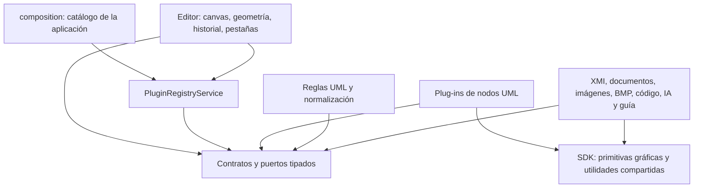

# Arquitectura microkernel del editor

El editor mantiene el lienzo, el arrastre, la geometría espacial, la selección, el viewport,
el historial, las pestañas y la orquestación. Las implementaciones UML y las herramientas
se conectan mediante contratos TypeScript y el registro. Se conserva el AST existente,
incluidos los identificadores y formatos usados por el backend.



## Directorios

- `core/plugins/`: contratos, registro, descubrimiento de nodos y outlet Angular.
- `core/plugins/contracts/`: puertos públicos de capacidades. No importan implementaciones.
- `composition/`: único lugar de producción que importa y reúne plug-ins concretos.
- `plugins/uml-*-node/`: renderizadores standalone con OnPush y signal inputs/outputs;
  descriptores de creación, dimensiones, restricciones, colores, capas y herramientas.
  Los nodos relacionados pueden compartir un renderizador dentro de su paquete;
  cada tipo tiene su propia definición registrable.
- `plugins/uml-language/`: reglas de relaciones, activaciones, edición de propiedades,
  compatibilidad, copiar/pegar y normalización del AST. La sincronización de documentos
  no depende del asistente de IA.
- `plugins/document-io/`: importación/exportación JSON y coordinación de formatos mediante
  los contratos de XMI y exportación de imágenes; la construcción del AST no activa esas herramientas.
- `plugins/xmi/`: parser XMI, adaptadores de Enterprise Architect y cliente HTTP.
- `plugins/image-export/`: captura y exportación PNG/BMP; solicita la codificación BMP mediante un puerto.
- `plugins/bmp-encoder/`: codificador binario, worker y fallback síncrono.
- `plugins/code-generation/`, `plugins/ai-assistant/`, `plugins/user-guide/`: servicios y UI propios.
- `plugin-sdk/`: componentes gráficos compartidos, controles UI, medición de texto,
  decodificación, factoría de nodos y geometría de conexiones. No importa implementaciones
  de plug-ins ni código de `features/`.
- `features/diagrams/diagram-editor/`: host y motor espacial; los barrels de servicios
  reexportan contratos para conservar las rutas de consumo del editor.

## Contratos y ciclo de vida

`PluginDefinition` declara metadatos (`id`, versión, `apiVersion`, categoría y clave i18n),
providers locales, capacidades tipadas, componentes públicos y hooks opcionales
`activate`/`deactivate`. Cada capacidad se identifica mediante un `InjectionToken<T>`.

`PluginRegistryService.register()` comprueba la versión del contrato, los identificadores,
las capacidades y las colisiones entre tipos de nodo antes de publicar el registro.
Crea un `EnvironmentInjector` propio y ejecuta `activate`. Si la activación falla,
destruye ese injector y no publica la definición. Los servicios se instancian al resolver
su capacidad por primera vez. El registro detecta resoluciones circulares.

`unregister(id)` retira la definición, ejecuta `deactivate` y destruye sus providers.
La lista de plug-ins es una Signal: la paleta y los renderizadores reaccionan a sus cambios.
El host no borra documentos al retirar un renderizador; muestra una indicación traducida
y conserva los datos y dimensiones persistidas del nodo desconocido.

Los hooks son síncronos. La composición incluida usa importaciones estáticas; **registro
dinámico no significa descarga remota ni carga diferida del código**. Se puede cargar un
módulo con `import()` en la composición y registrar su definición cuando esté disponible.
Los plug-ins ejecutan código de confianza en el mismo proceso; este mecanismo no es un sandbox.
Los consumidores que conservan un servicio inyectado deben terminar su operación antes de
retirar ese plug-in. Las herramientas visuales usan el injector del plug-in y se destruyen
al dejar de estar publicadas.

## Extender el editor

1. Crear `plugins/<dominio>/<tipo>.plugin.ts` y su componente standalone.
2. Implementar `NodePlugin`: `nodeTypes`, `renderer`, `create`, `inputs`, `geometry`,
   `defaultColor` y `tools`. Una herramienta puede declarar su icono, diagramas admitidos
   y estereotipo. El core crea los botones mediante los controles compartidos.
3. El componente recibe los inputs declarados por el descriptor y emite los eventos
   estandarizados `nodeClick`, `deleteNode`, `tableClick`, `labelDblClick`, `commitRename`
   y `cancelRename` según sus capacidades. El host conserva la selección y los bloqueos.
4. Registrar la definición en `composition/node-plugins.ts`, o llamar a `register()` en
   ejecución. No añadir condiciones al canvas, la factoría ni las métricas del núcleo.
5. Añadir las claves de metadatos y textos a ambas traducciones (`es.ts` y `en.ts`).

Para herramientas y servicios, definir un puerto en `core/plugins/contracts/`, publicarlo
como una capacidad y resolverlo a través del registro. Una herramienta que necesita otra
capacidad importa **su contrato**, nunca el servicio o componente del otro plug-in.

`DiagramExportCanvasTarget` permite preparar la captura, obtener el elemento DOM y restaurar
el viewport sin exponer Foblex al exportador. El lienzo implementa este contrato; el exportador
ejecuta la restauración incluso cuando falla la captura. `UmlDiagramProject` reside en los
modelos de Core y define el documento JSON compartido por los importadores.

El outlet usa `ViewContainerRef` para conservar la jerarquía de inyección de Angular y
Foblex. El `fNode` permanece en el host; los renderizadores pueden aportar conectores
hijos. Los cambios de inputs conservan la instancia y sus subscriptions; cambiar o retirar
el renderer destruye la instancia y cancela las subscriptions.

## Verificación

```sh
npm run check:architecture
npm test -- --watch=false
npm run build
```

La comprobación de límites incluye los specs y prohíbe importaciones del núcleo/SDK a
implementaciones, importaciones entre paquetes de plug-ins y dependencias hacia `features/`
desde Core, SDK o plug-ins. Resuelve alias TypeScript y revisa reexportaciones e importaciones
dinámicas y de tipos. Los plug-ins consumen únicamente su paquete, Core, SDK y bibliotecas
externas; las pruebas de integración entre implementaciones se alojan en `composition/`.
También prohíbe comparaciones concretas de `nodeType` en el código de producción del núcleo.
`npm run test:architecture` prueba estas reglas con casos permitidos y rechazados, y se
ejecuta antes de la suite Angular. Las pruebas verifican registro y colisiones, instanciación diferida, ciclo de vida,
inputs/outputs dinámicos, creación de una extensión desconocida, geometría y guardado sin
IA/XMI/exportadores instalados, además de las regresiones existentes de UML, XMI e imágenes.
La verificación de DOM en jsdom no sustituye una revisión visual en navegador de arrastre,
conectores y exportación.

## Capacidad de voz del asistente

`AiAssistantService.speech(diagramId, messageId, voice)` amplía el puerto con una descarga
binaria autenticada. El núcleo no conoce Edge TTS ni administra audio. Captura y reproducción
residen en servicios independientes del plug-in `ai-assistant`; la síntesis y su caché pertenecen
a FastAPI, detrás de NestJS. La voz no aplica propuestas ni modifica el historial del canvas.

## Importación de repositorios EA

El plug-in `xmi` publica el slot `importDialog` y los métodos `previewQea`/`importQea`
del contrato `XmiService`. El modal administra archivo, selección y estado HTTP. El host
abre el slot por registro; SQLite, traducción QEA y persistencia residen en NestJS.
El explorador recibe la colección actualizada mediante el servicio de documentos del Core.
