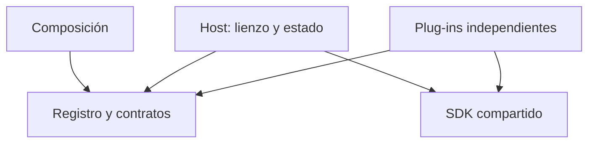

# 00 — Arquitectura y configuración del frontend

## Stack y configuración Angular

La aplicación usa **Angular 22**, TypeScript 6, Tailwind CSS v4, Foblex Flow 19 y Vitest 4.
La numeración de Foblex es independiente de Angular. Los rangos declarados están en
[package.json](../package.json); consultar `node_modules/<paquete>/package.json` para la versión
instalada. Este checkout no contiene lockfile; si se incorpora uno, usarlo como referencia
de resolución y para instalaciones reproducibles.

[app.config.ts](../src/app/app.config.ts) instala `provideEditorPlugins()`,
`provideZonelessChangeDetection()`, los listeners globales de errores, HttpClient con
`jwtInterceptor` y el router con `withHashLocation()`. Los componentes nuevos son standalone,
con OnPush y Signals; las actualizaciones desde callbacks externos deben notificar a Angular.

Las rutas reales son `/login`, `/register`, `/projects`, `/diagram` y `/diagrams/:id`,
según [app.routes.ts](../src/app/app.routes.ts). Las vistas de proyectos y diagramas usan `authGuard`.

## Partición microkernel

```text
src/app/
├── core/
│   ├── plugins/            # Contratos, registro, outlet y capacidades
│   ├── models/             # AST, UmlDiagramProject, proyectos y usuarios
│   ├── services/           # Sesión, HTTP, colaboración, tema y notificaciones
│   └── i18n/               # Traducciones es/en
├── composition/            # Catálogo concreto e integración de plug-ins
├── plugin-sdk/             # Factoría, geometría compartida, UI y utilidades
├── plugins/                # Paquetes independientes por dominio
└── features/               # Pantallas de autenticación, proyectos y host del editor
```

El Core System comprende la infraestructura del registro en `core/plugins/` y el host del
editor en `features/diagrams/diagram-editor/`. El nombre de la carpeta `core/` no implica
que todas las funciones del producto deban vivir allí.

| Origen | Dependencias internas admitidas |
| --- | --- |
| Core | Modelos, contratos y servicios de infraestructura de Core. |
| SDK | Core y otras utilidades del SDK. |
| Un plug-in | Core, SDK y archivos de su propio paquete. |
| Host | Core, SDK y servicios propios del host; resuelve extensiones por contrato/registro. |
| Composición | Definiciones concretas de plug-ins y contratos de registro. |

Las bibliotecas externas se consumen según la responsabilidad de cada paquete.
El verificador también analiza los specs; las integraciones entre implementaciones viven
en `composition/`. Las pruebas del host/SDK pueden usar la composición como fixture.



Los plug-ins se registran y retiran en ejecución; el catálogo actual se importa estáticamente.
Esto no representa descarga remota de código ni aislamiento de seguridad entre extensiones.
Ver [MICROKERNEL.md](../MICROKERNEL.md) para el ciclo de vida y sus límites.

## Entornos

[angular.json](../angular.json) selecciona los reemplazos de archivos:

| Configuración | Archivo | Conexión |
| --- | --- | --- |
| Desarrollo web | `src/environments/environment.ts` | API local en puerto 4000. |
| Producción web | `src/environments/environment.prod.ts` | API de producción configurada en el archivo. |
| `electron-local` | `src/environments/environment.electron.ts` | Backend local para escritorio. |
| `electron-prod` | `src/environments/environment.prod.ts` | Backend de producción. |

Las propiedades son `apiUrl`, `socketUrl` y `production`. No duplicar URLs en componentes.
El proceso principal de Electron está en [main.js](../main.js).

## Comandos

| Comando | Resultado |
| --- | --- |
| `npm install` | Instala las dependencias; si se incorpora un lockfile, usar `npm ci` en CI. |
| `npm start` | Servidor de desarrollo web. |
| `npm run check:architecture` | Análisis AST de límites de dependencia. |
| `npm run test:architecture` | Pruebas del propio verificador. |
| `npm test -- --watch=false` | Suite Angular/Vitest, con controles de arquitectura previos. |
| `npm run build` | Verifica arquitectura y genera la compilación de producción en `dist/frontend`. |
| `npm run electron:start` | Compila para escritorio local y abre Electron. |
| `npm run build:electron:prod` | Compila para escritorio conectado a producción. |

Los scripts específicos de Electron llaman a `ng build` directamente; no suponer que pasan
por el hook `prebuild` de `npm run build`. Ejecutar el control de arquitectura al validar esos flujos.
