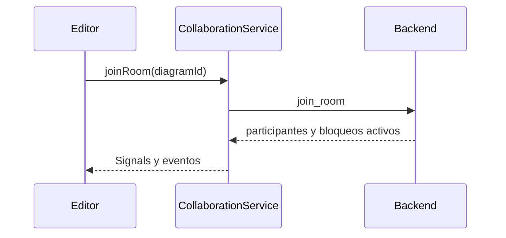

# 04 — Colaboración en tiempo real y WebSockets

## Transporte y coordinación

[CollaborationService](../src/app/core/services/collaboration.service.ts) mantiene el transporte
Socket.IO, participantes, cursores y bloqueos. El
[DiagramCollaborationCoordinatorService](../src/app/features/diagrams/diagram-editor/services/collaboration-ai-io/diagram-collaboration-coordinator.service.ts)
conecta esos eventos con las acciones del host.

La colaboración sigue en la infraestructura del editor. Los renderizadores de nodos reciben
el estado de bloqueo mediante su contexto; no abren sockets por nodo ni dependen de otro plug-in.
La semántica necesaria para aplicar datos de documentos se consulta por contratos de dominio.

## Sesión y eventos actuales

El endpoint se toma de `environment.socketUrl`; en desarrollo es
`http://localhost:4000/collaboration`. `joinRoom(diagramId, customRoomCode?)` guarda el diagrama
activo, conecta el socket y emite `join_room` con los datos de la sesión. La respuesta actualiza
`activeRoomCode`, `collaborators` y `activeNodeLocks`.

| Evento | Uso |
| --- | --- |
| `room_participants_updated`, `user_joined` | Actualizar participantes de la sesión. |
| `cursor_move` → `cursor_moved` | Enviar y recibir posiciones de cursores. |
| `lock_node` → `node_locked` | Solicitar y reflejar un bloqueo. |
| `node_lock_rejected` | Rechazar una edición por bloqueo de otro usuario. |
| `unlock_node` → `node_unlocked` | Liberar el bloqueo y actualizar el estado. |
| `diagram_saved` | Notificar el guardado del servidor. |

Estos nombres describen el cliente actual; consultar su implementación al modificar el
protocolo. No cambiar payloads o nombres unilateralmente sin revisar el backend.

## Cursores, bloqueos y estado

Las posiciones remotas se representan en coordenadas del documento. Usar las conversiones
del host/viewport para mantener consistencia con el zoom y paneo. El transporte limita la
frecuencia de envío de cursores y drag; no emitir un guardado completo por cada movimiento.

El coordinador consulta `isNodeLockedByOther()` y expone los datos del propietario. El host
aplica las restricciones de edición y entrega `isLocked`/`isReadOnly` al renderer del plug-in.
Los indicadores visuales por sí solos no autorizan una mutación; el servidor conserva la
responsabilidad de validar permisos y concurrencia.

## Reconexión y limpieza

El servicio habilita reconexión Socket.IO. En `connect`, si hay un diagrama activo, vuelve a
emitir `join_room`; en `disconnect` vacía cursores y bloqueos locales. El coordinador entrega
suscripciones de `setupSubscriptions(actions)` y la acción `onReconnected` al host para
restablecer el documento según su flujo vigente.

Cancelar suscripciones y abandonar la sesión al terminar su ciclo de vida. Un cambio de
renderer o la retirada de una herramienta opcional no debe crear otra sesión colaborativa.
Al validar cambios, revisar edición concurrente, rechazo de bloqueo, reconexión y cambio
de pestaña/diagrama; las pruebas unitarias no sustituyen una sesión real con dos clientes.
