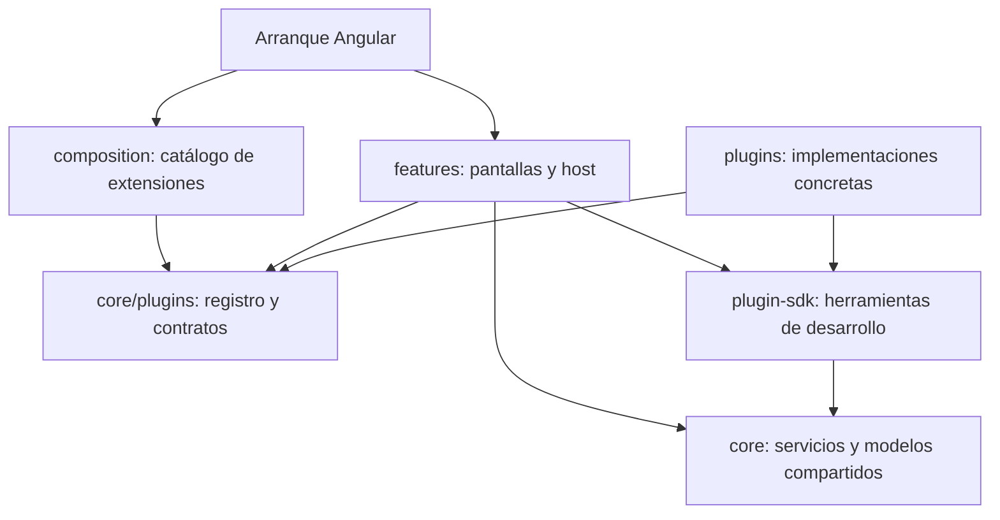
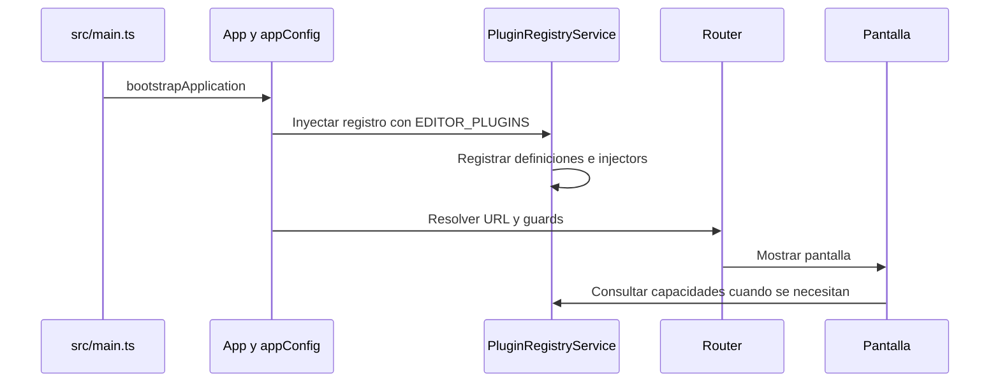
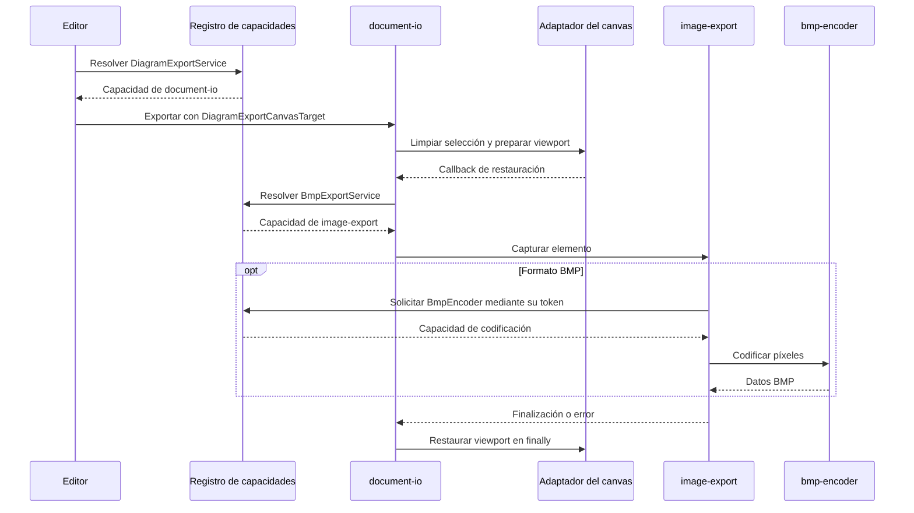

# 07 — Mapa de directorios y funcionamiento del frontend

Este documento explica dónde vive cada responsabilidad y cómo se conectan las piezas del
frontend **Angular 22**. Está dirigido a quien necesita orientarse antes de leer o modificar
el editor. Las rutas de las tablas son relativas a la raíz del frontend, salvo indicación contraria.

## 1. Vista general

El proyecto aplica arquitectura **microkernel**: una base estable mantiene el editor y sus
extensiones aportan los comportamientos UML y las herramientas. El núcleo arquitectónico
no es solamente la carpeta `core/`: también comprende el host y su motor espacial, alojados
en `features/diagrams/diagram-editor/`.



Las flechas de este gráfico indican uso o configuración de otra capa. El host obtiene
renderizadores y capacidades desde el registro: no importa directamente las clases de los
plug-ins. Que el registro pueda entregar una instancia no significa que sus contratos
importen la implementación.

## 2. Directorios y archivos de la raíz

| Ruta | Responsabilidad | Cuándo trabajar aquí |
| --- | --- | --- |
| `src/` | Código fuente de la aplicación Angular. | Cambios de comportamiento, pantallas o estilos. |
| `public/` | Recursos estáticos que copia el builder según `angular.json`. | Imágenes, iconos y archivos públicos. |
| `guia-desarrollador/` | Explicaciones por área técnica. | Mantener instrucciones y recorridos de desarrollo. |
| `scripts/` | Verificador AST de límites y sus pruebas. | Cambiar reglas automáticas de arquitectura. |
| `.agents/` | Skill, reglas y workflows para asistencia de desarrollo. | Actualizar instrucciones del proyecto. No forma parte de la aplicación. |
| `.github/` | Configuración de colaboración y automatización del repositorio. | Mantener los archivos que existan allí; no implica que haya un pipeline para cada tarea. |
| `.angular/` | Caché y archivos auxiliares de Angular CLI. | Normalmente no se edita manualmente. |
| `node_modules/` | Dependencias instaladas y sus guías/API locales. | Consultar versiones y documentación; modificar dependencias desde `package.json`. |
| `dist/` | Compilación generada de Angular. | Inspeccionar el resultado; editar el código fuente, no estos archivos. |
| `release/` | Artefactos de empaquetado de escritorio. | Revisar instaladores/binarios generados por Electron Builder. |
| `graphify-out/` | Salidas auxiliares del análisis del repositorio. | Consultar análisis; no colocar código de la aplicación. |
| `.git/`, `.idea/`, `.codex/`, `.aws/` | Metadatos de Git o del entorno local y herramientas. | Fuera de la arquitectura Angular; no almacenar aquí funcionalidades ni copiar configuración privada a `src/`. |

Archivos de configuración importantes:

| Archivo | Para qué sirve |
| --- | --- |
| [package.json](../package.json) | Dependencias, scripts npm y configuración de Electron Builder. |
| [angular.json](../angular.json) | Builder, assets, entornos, pruebas y presupuestos de compilación. |
| [tsconfig.json](../tsconfig.json) | Opciones TypeScript y compilador Angular. |
| [tsconfig.app.json](../tsconfig.app.json), [tsconfig.spec.json](../tsconfig.spec.json) | Alcances de compilación de aplicación y pruebas. |
| [vitest.config.ts](../vitest.config.ts) | Configuración complementaria de Vitest; comprobar también cómo se integra desde el builder. |
| `.postcssrc.json`, `.prettierrc`, `.editorconfig` | PostCSS y convenciones de formato. |
| [main.js](../main.js) | Proceso principal de Electron y apertura de la aplicación de escritorio. |
| [shell.nix](../shell.nix) | Entorno de herramientas y librerías para ejecución en Nix. |
| [AGENTS.md](../AGENTS.md) | Reglas de trabajo para agentes en este frontend. |
| [MICROKERNEL.md](../MICROKERNEL.md) | Referencia de límites, contratos y ciclo de vida de extensiones. |

Los archivos sueltos de ejemplo, como `prueba.json`, y el PDF de referencia arquitectónica
no son módulos de ejecución. No confundirlos con el catálogo de plug-ins ni con persistencia del usuario.

## 3. Arranque: de `src/` a una pantalla

| Ruta | Función |
| --- | --- |
| [src/main.ts](../src/main.ts) | Ejecuta `bootstrapApplication(App, appConfig)`. |
| `src/index.html` | Documento HTML que contiene el punto de montaje de Angular. |
| `src/styles.css` | Estilos globales, Tailwind y reglas compartidas de presentación. |
| `src/environments/` | `apiUrl`, `socketUrl` y bandera `production`; variantes web y Electron. |
| `src/app/app.config.ts` | Instala proveedores: catálogo de plug-ins, zoneless, router y HttpClient. |
| `src/app/app.routes.ts` | Relaciona rutas con pantallas y guards. |
| `src/app/app.ts`, `app.html`, `app.css` | Contenedor raíz, router outlet, notificaciones, confirmación y extensión de ayuda. |



`provideEditorPlugins()` configura el catálogo por DI; el registro procesa ese catálogo al
instanciarse. Las capacidades se crean de forma diferida, no todas durante el arranque.
La composición usa imports estáticos: registro dinámico no equivale a descarga remota de código.

Las rutas actuales son `/login`, `/register`, `/projects`, `/diagram` y `/diagrams/:id`.
El router usa hash. El [capítulo 00](00-ARQUITECTURA-Y-CONFIGURACION.md) explica los entornos.

## 4. `src/app/core/`: infraestructura compartida

| Subdirectorio | Responsabilidad | Ejemplo |
| --- | --- | --- |
| `components/` | UI transversal de la aplicación. | Confirmaciones, toasts y selector de tema. |
| `guards/` | Control de acceso a rutas desde el cliente. | `authGuard` consulta la sesión y redirige al login. |
| `interceptors/` | Comportamiento transversal de HttpClient. | `jwtInterceptor` agrega el token disponible. |
| `models/` | Formas de datos compartidas. | AST, `UmlDiagramProject`, autenticación, proyectos y usuarios. |
| `services/` | Infraestructura de aplicación. | Auth, proyectos, diagramas, Socket.IO, tema y notificaciones. |
| `i18n/` | Idioma, traducción y diccionarios. | `TranslationService`, `TranslatePipe`, español e inglés. |
| `plugins/` | Mecanismo de extensión del microkernel. | Registro, contratos y montaje dinámico. |

Dentro de `core/i18n/`, `models/` define idiomas, `services/` mantiene la preferencia,
`pipes/` traduce plantillas, `components/` presenta el selector y `translations/` contiene
`es.ts`/`en.ts`. Toda nueva cadena visible debe tener claves en ambos diccionarios.

Los servicios de `core/services/` no incluyen las implementaciones de IA, XMI, BMP o generación
de código: esas herramientas pertenecen a sus plug-ins. El control de acceso del cliente
no reemplaza la validación de permisos del backend.

### `core/plugins/`: las reglas y el mecanismo de conexión

Esta carpeta no es el catálogo de herramientas. Define cómo se conecta una herramienta:

| Archivo o carpeta | Papel |
| --- | --- |
| `plugin.contract.ts` | `PluginDefinition`, metadatos, capacidades, providers, hooks y `EDITOR_PLUGINS`. |
| `node-plugin.contract.ts` | Contrato `NodePlugin`, contexto, renderer, herramientas y geometría. |
| `plugin-registry.service.ts` | Registro, descubrimiento, resolución diferida y retirada de extensiones. |
| `node-plugin-registry.service.ts` | Busca definiciones de nodo por tipo o alias de estereotipo. |
| `plugin-outlet.directive.ts` | Crea un componente descubierto y enlaza inputs, outputs e injector. |
| `contracts/` | Interfaces y tokens para solicitar capacidades sin importar su implementación. |

Cada plug-in tiene su propio `EnvironmentInjector`. `register()` valida colisiones y ejecuta
`activate`; `resolve(token)` crea/cachea la capacidad; `unregister()` retira la definición,
ejecuta `deactivate` y destruye su injector. Los hooks son síncronos y las extensiones comparten
el proceso de confianza de la aplicación; esto no es un sandbox.

## 5. `src/app/plugin-sdk/`: piezas reutilizables para construir extensiones

El SDK evita duplicar herramientas que varios plug-ins y el host necesitan. No decide qué
plug-ins se instalan ni debe conocer implementaciones de otros paquetes.

| Ruta dentro del SDK | Qué aporta |
| --- | --- |
| `diagram-node-factory.service.ts` | Delega la creación a `NodePluginRegistryService.require(type).create(context)`. |
| `geometry/` | Layout compartido de conexiones, puertos y cálculos espaciales. |
| `ui/shared-ui/` | Controles de zoom, estilos de línea, botones de relación/herramienta y cabeceras. |
| `ui/uml-svg/` | Primitivas SVG para figuras, iconos y marcadores. |
| `ui/diagram-floating-label/` | Etiquetas desplazables reutilizables. |
| `ui/autofocus-input.directive.ts` | Foco de campos durante la edición. |
| `text-metrics.ts` | Medición compartida de texto. |
| `node-creation.ts` | Utilidades compartidas de posición inicial. |
| `text-decoding.ts` | Normalización de texto recibido. |
| `sequence-colors.ts` | Convenciones de color compartidas. |

Un SVG de actor es una pieza visual del SDK; el plug-in actor agrega su contrato completo,
creación, dimensiones, herramientas y comportamiento de nodo. Los componentes WebGL se eliminaron.

## 6. `src/app/plugins/`: funcionalidades concretas

Cada subcarpeta es un paquete de dominio independiente. Puede tener descriptor `*.plugin.ts`,
servicios, componentes, templates, helpers y pruebas. Compartir un renderer dentro de un paquete
no autoriza importarlo desde otro paquete.

### Nodos: ocho paquetes, trece definiciones registrables

| Paquete | Tipos | Responsabilidad |
| --- | --- | --- |
| `uml-class-node/` | `class` | Clase UML, atributos, métodos y métricas propias. |
| `uml-actor-node/` | `actor` | Actor y etiqueta. |
| `uml-use-case-node/` | `use_case` | Caso de uso elíptico. |
| `uml-package-node/` | `package`, `boundary_box` | Paquetes y contenedores visuales. |
| `uml-robustness-node/` | `boundary`, `control`, `entity` | Notación BCE. |
| `uml-lifeline-node/` | `lifeline` | Línea de vida y presentación de activaciones. |
| `uml-component-node/` | `component` | Componentes y sus puertos. |
| `uml-deployment-node/` | `node`, `device`, `executionEnvironment` | Despliegue con perspectiva SVG. |

Cada descriptor publica `geometry`, `renderer`, `tools`, `create()` e `inputs()`. El canvas
consume esos datos sin contener un catálogo de clases de componentes concretos.

### Dominio y herramientas

| Paquete | Qué contiene y de qué se encarga |
| --- | --- |
| `uml-language/` | Semántica UML, operaciones de nodos/conexiones, copiar/pegar, activaciones, normalización y sincronización de documentos. `logic/` contiene funciones de dominio; `edit-node-modal/` y `edit-connection-modal/`, editores de propiedades. |
| `document-io/` | Importación/exportación JSON, construcción del payload AST y coordinación de formatos por contratos. |
| `xmi/` | Cliente HTTP y parser XMI; `parsers/` divide la interpretación de clasificadores, comportamiento, relaciones y layout. |
| `image-export/` | Captura de elementos y exportación PNG/BMP. Solicita el codificador mediante un contrato. |
| `bmp-encoder/` | Codificación BMP, worker y alternativa sin worker. |
| `code-generation/` | Cliente HTTP de generación y `spring-boot-modal/` con explorador de código. |
| `ai-assistant/` | Cliente de asistencia y `ai-assistant-panel/`, con sus helpers de imágenes/cámara. |
| `user-guide/` | Servicio de ayuda y `chatbot/`, publicados en un slot visual. |

`DiagramDocumentSyncService` está en `uml-language`: aplicar o normalizar documentos no
requiere IA. XMI, imágenes y generación de código se resuelven cuando la operación las necesita.

## 7. `src/app/composition/`: qué extensiones instala esta aplicación

| Archivo | Función |
| --- | --- |
| `node-plugins.ts` | Reúne las definiciones de nodos disponibles. |
| `editor-plugins.ts` | Reúne nodos y herramientas; expone `provideEditorPlugins()`. |
| `*.spec.ts` | Pruebas que integran implementaciones y verifican el host con distintos catálogos. |

Composición puede importar definiciones concretas de varios plug-ins. El host y los plug-ins
no usan composición como atajo para acceder a implementaciones. Añadir una carpeta a
`plugins/` no instala automáticamente su extensión: debe registrarse.

## 8. `src/app/features/`: pantallas y host del editor

| Carpeta | Responsabilidad |
| --- | --- |
| `auth/login/` | Pantalla de inicio de sesión. |
| `auth/register/` | Pantalla de registro. |
| `projects/project-list/` | Listado y acciones de gestión de proyectos. |
| `diagrams/diagram-editor/` | Coordinación del editor, componentes del host y servicios de interacción. |

### Componentes del host

Dentro de `features/diagrams/diagram-editor/components/`:

| Carpeta | Papel en la interfaz |
| --- | --- |
| `diagram-canvas/` | Contenedor Foblex, renderizado dinámico, selección e interacción del lienzo. |
| `diagram-sidebar/` | Explorador y herramientas; utilidades de orden y drag del panel. |
| `diagram-toolbox/` | Controles de herramientas del editor. |
| `diagram-appbar/` | Acciones superiores: guardado, herramientas y estado de sesión. |
| `diagram-tabs/` | Navegación entre diagramas abiertos. |
| `diagram-statusbar/` | Información de estado del editor. |
| `diagram-context-menu/` | Acciones contextuales. |
| `create-diagram-modal/` | Creación de un documento de diagrama. |
| `json-modal/` | Interacción con la representación JSON del documento. |
| `user-profile-modal/` | Edición/consulta de perfil desde la interfaz. |

Los modales de edición UML, código e IA pertenecen a sus plug-ins, no a esta carpeta.
`diagram-editor.component.ts` coordina los eventos; su HTML monta host y slots de extensiones.
`diagram-editor.icons.ts` reúne los iconos utilizados por el editor.

### Servicios del host

Dentro de `features/diagrams/diagram-editor/services/`:

| Carpeta | Responsabilidades que conserva |
| --- | --- |
| `orchestration/` | Toolbar, atajos, modales, menú contextual, interacción, contexto y pestañas. |
| `state-persistence/` | Persistencia, historial de estados y selección. |
| `spatial-engine/` | Geometría del canvas, drag, contención, alineación, viewport y coordinación de conexiones de ensamble. |
| `uml-domain/` | Redimensionamiento del host y barrel de contratos/SDK. Las operaciones UML están en el plug-in de dominio. |
| `collaboration-ai-io/` | Coordinador de colaboración y barrel de contratos. Las implementaciones de IA/importación/exportación ya están en plug-ins. |

Los nombres de los dos últimos directorios son heredados. **Un `index.ts` que reexporta un
símbolo no es el propietario de su implementación**. Revisar el destino del export antes de
mover o ampliar un servicio. La geometría compartida de conexiones y la factoría viven en el SDK.

En `utils/`, `canvas-coordinates.util.ts` ayuda con coordenadas,
`node-metrics.util.ts` consulta métricas del registro y `project-role.util.ts` resuelve roles.
No convertir estas utilidades del host en otro lugar para condiciones específicas de cada nodo.

## 9. Recorrido práctico: crear y renderizar un actor

```mermaid
sequenceDiagram
    participant User as Usuario
    participant UI as Paleta del host
    participant Factory as Factoría del SDK
    participant Registry as Registro de nodos
    participant Actor as Plug-in actor
    participant Canvas as Canvas y outlet
    User->>UI: Elegir herramienta actor
    UI->>Factory: create(tipo, contexto)
    Factory->>Registry: require(tipo)
    Registry-->>Factory: Descriptor del nodo
    Factory->>Actor: create(contexto)
    Actor-->>UI: Datos del nuevo nodo
    UI->>Canvas: Actualizar documento mediante el host
    Canvas->>Registry: forNode(nodo)
    Registry-->>Canvas: Renderer, geometría e injector
    Canvas->>Actor: Montar renderer con inputs
    Actor-->>Canvas: Emitir eventos de interacción
```

Es un recorrido conceptual: los handlers y servicios de orquestación median los pasos de UI.
El actor conoce cómo representarse; el host conserva permisos, bloqueos, selección e historial.
El `fNode` queda en el host y el renderer se monta como hijo para conservar la inyección de Foblex.

## 10. Recorrido práctico: exportar una imagen



Las flechas entre instancias representan llamadas **a través de contratos**; no imports entre
paquetes. PNG no necesita codificación BMP para su formato. La disponibilidad y el momento de
instanciación de dependencias también dependen de cómo cada servicio inyecta sus tokens.

Guardar el AST es otro recorrido: el host coordina persistencia, usa las capacidades de documento
y dominio para preparar datos y envía el payload mediante `DiagramService`. No requiere activar
el panel IA ni exportadores. En colaboración, `CollaborationService` mantiene el transporte y
el coordinador del host aplica sus eventos; ver [capítulo 04](04-COLABORACION-TIEMPO-REAL-Y-WEBSOCKETS.md).

## 11. Dónde colocar un cambio

| Necesidad | Lugar inicial |
| --- | --- |
| Nuevo tipo de nodo | Nuevo descriptor/renderer en `plugins/` y registro en `composition/`. |
| Nuevo formato o herramienta | Paquete de plug-in y contrato de capacidad en Core. |
| Nueva capacidad que varios plug-ins consumen | Interfaz/token en `core/plugins/contracts/`. |
| Utilidad visual o matemática reutilizable | `plugin-sdk/`, sin imports de `features/` o implementaciones de plug-ins. |
| Cambio de zoom, drag, selección o pestañas | Host y servicios del editor. |
| Regla de relaciones o normalización UML | `plugins/uml-language/`. |
| Traducción | Ambos diccionarios de `core/i18n/translations/`. |
| Cambio de URL del backend | `src/environments/`. |
| Prueba unitaria de un plug-in | Su propio paquete. |
| Prueba que integra varios plug-ins concretos | `composition/`. |
| Nueva prohibición de dependencias | `scripts/check-plugin-boundaries.mjs` y su spec. |

## 12. Reglas de dependencia y validación

- Un plug-in usa su paquete, Core, SDK y bibliotecas externas; no importa otro plug-in.
- Core, SDK y plug-ins no importan `features/`.
- El host obtiene extensiones mediante contratos/registro; composición reúne las implementaciones.
- Los tests también respetan los límites; el host/SDK pueden usar composición como fixture.
- Las herramientas opcionales no deben convertirse en requisitos del camino mínimo del editor.

Ejecutar:

```sh
npm run test:architecture
npm run check:architecture
npm test -- --watch=false
npm run build
```

El verificador AST detecta varias violaciones de imports y ramas concretas de `nodeType`;
no demuestra por sí solo independencia semántica ni cubre todas las formas de acoplamiento.
Las pruebas verifican comportamientos y la compilación comprueba tipos/templates. Para cambios
visuales, revisar también drag, conectores, zoom y exportación en navegador.

Los gráficos de este documento están escritos en **Mermaid**. Para verlos renderizados, usar
un visor Markdown compatible con Mermaid; un visor sin soporte mostrará sus bloques de código.
